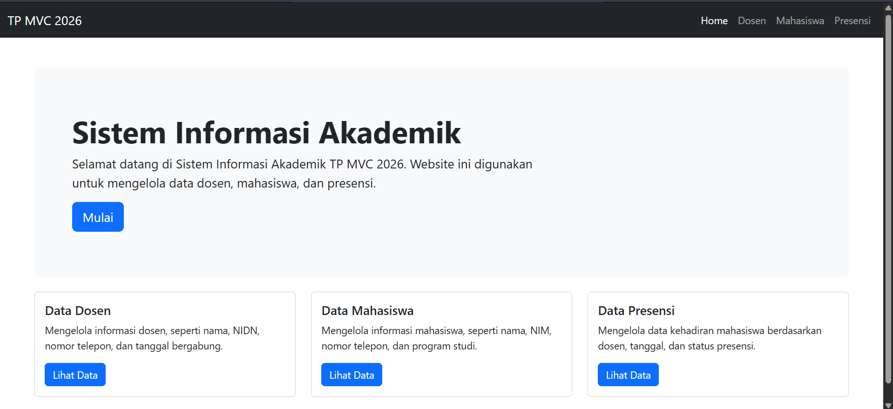

# Tugas Praktikum 8 DPBO 

## Deskripsi Program

TP MVC 2026 merupakan aplikasi Sistem Informasi Akademik sederhana yang dikembangkan menggunakan PHP Native dengan konsep Object-Oriented Programming (OOP) dan arsitektur Model-View-Controller (MVC).

Aplikasi ini digunakan untuk mengelola data dosen, mahasiswa, dan presensi dengan menerapkan fitur CRUD (*Create, Read, Update, Delete*) yang terhubung dengan database MySQL.

---

# 1. Desain Program

## 1.1 Teknologi yang Digunakan

| Teknologi | Kegunaan |
|---|---|
| PHP Native | Bahasa pemrograman utama |
| MySQL | Pengelolaan database |
| MySQLi | Koneksi PHP dengan database |
| HTML5 | Struktur halaman web |
| CSS3 | Pengaturan tampilan tambahan |
| Bootstrap 5 | Antarmuka aplikasi |

## 1.2 Fitur Aplikasi

Aplikasi memiliki tiga fitur utama:

- **Data Dosen:** Mengelola informasi dosen, meliputi nama, NIDN, nomor telepon, dan tanggal bergabung.
- **Data Mahasiswa:** Mengelola informasi mahasiswa, meliputi nama, NIM, nomor telepon, dan program studi.
- **Data Presensi:** Mengelola kehadiran mahasiswa berdasarkan dosen, tanggal, dan status presensi (Hadir, Izin, Sakit, dan Alpa).

Setiap fitur memiliki operasi CRUD untuk menambahkan, menampilkan, mengubah, dan menghapus data.

## 1.3 Arsitektur MVC

Aplikasi menerapkan arsitektur Model-View-Controller (MVC) yang membagi tanggung jawab program menjadi tiga bagian:

| Komponen | Fungsi |
|---|---|
| Model | Mengelola data dan menjalankan query database. |
| View | Menampilkan data dan antarmuka aplikasi. |
| Controller | Mengatur alur aplikasi serta menghubungkan Model dengan View. |

File `index.php` berfungsi sebagai router utama untuk menentukan Controller dan fungsi yang akan dijalankan.

## 1.4 Desain Database

Database yang digunakan bernama `tp_mvc26` dan memiliki tiga tabel:

### A. lecturers

| Atribut | Tipe Data | Keterangan |
|---|---|---|
| id_lecturer | INT | Primary Key |
| name | VARCHAR(100) | Nama dosen |
| nidn | VARCHAR(30) | NIDN |
| phone | VARCHAR(20) | Nomor telepon |
| join_date | DATE | Tanggal bergabung |

### B. students

| Atribut | Tipe Data | Keterangan |
|---|---|---|
| id_student | INT | Primary Key |
| name | VARCHAR(100) | Nama mahasiswa |
| nim | VARCHAR(30) | NIM |
| phone | VARCHAR(20) | Nomor telepon |
| prodi | VARCHAR(100) | Program studi |

### C. attendance

| Atribut | Tipe Data | Keterangan |
|---|---|---|
| id_attendance | INT | Primary Key |
| id_student | INT | Foreign Key |
| id_lecturer | INT | Foreign Key |
| attendance_date | DATE | Tanggal presensi |
| status | ENUM | Status presensi |

Tabel `attendance` memiliki relasi dengan tabel `students` melalui `id_student` dan tabel `lecturers` melalui `id_lecturer`. Dengan demikian, setiap presensi terhubung dengan mahasiswa dan dosen yang bersangkutan.

## 1.5 Struktur Folder

### Struktur Project

```text
TP8DPBO2526/
│
├── tp_mvc26.sql                 # Berisi perintah SQL untuk membuat database dan tabel.
├── README.md                    # Berisi penjelasan project, desain, alur, dan dokumentasi.
│
├── Dokumentasi/
│   ├── Tampilan_awal.png        # Dokumentasi tampilan awal aplikasi.
│   └── Proses_CRUD.mp4          # Rekaman proses Create, Read, Update, dan Delete.
│
└── Project/
    └── tp_mvc26/
        │
        ├── assets/
        │   ├── css/
        │   │   ├── style.css                # Mengatur tampilan tambahan aplikasi.
        │   │   └── bootstrap.min.css        # File CSS Bootstrap.
        │   │
        │   └── js/
        │       ├── bootstrap.bundle.min.js  # JavaScript Bootstrap beserta Popper.js.
        │       ├── bootstrap.min.js         # JavaScript Bootstrap.
        │       └── popper.min.js            # Library Popper.js.
        │
        ├── controllers/
        │   ├── LecturerController.php       # Mengatur alur pengelolaan data dosen.
        │   ├── StudentController.php        # Mengatur alur pengelolaan data mahasiswa.
        │   └── AttendanceController.php     # Mengatur alur pengelolaan data presensi.
        │
        ├── models/
        │   ├── DB.php                       # Mengatur koneksi dan eksekusi query database.
        │   ├── Lecturer.php                 # Menangani CRUD tabel lecturers.
        │   ├── Student.php                  # Menangani CRUD tabel students.
        │   └── Attendance.php               # Menangani CRUD tabel attendance.
        │
        ├── views/
        │   ├── LecturerView.php              # Menampilkan halaman data dosen.
        │   ├── StudentView.php               # Menampilkan halaman data mahasiswa.
        │   └── AttendanceView.php            # Menampilkan halaman data presensi.
        │
        └── index.php                         # Halaman utama sekaligus pengatur routing aplikasi.
```

# 2. Alur Program

## 2.1 Alur MVC

Secara umum, proses aplikasi berjalan melalui tahapan berikut:

```text
       USER
         |
         v
      index.php
       (Router)
         |
         v
     CONTROLLER
         |
         v
       MODEL
         |
         v
      DATABASE
         |
         v
       MODEL
         |
         v
     CONTROLLER
         |
         v
        VIEW
         |
         v
   TAMPILAN APLIKASI
```

1. Pengguna mengakses aplikasi melalui browser.
2. `index.php` menentukan Controller berdasarkan menu yang dipilih.
3. Controller memanggil Model untuk mengambil atau mengolah data.
4. Model berinteraksi dengan database.
5. Hasil pengolahan data diteruskan kembali ke Controller.
6. Controller mengirimkan data ke View untuk ditampilkan.

## 2.2 Alur CRUD

| Operasi | Alur Proses |
|---|---|
| Create | Pengguna mengisi form, Controller menerima data, Model menjalankan INSERT. |
| Read | Controller meminta data kepada Model, kemudian View menampilkannya dalam tabel. |
| Update | Pengguna memilih Edit, mengubah data melalui modal, kemudian Model menjalankan UPDATE. |
| Delete | Pengguna memilih Hapus, mengonfirmasi penghapusan, kemudian Model menjalankan DELETE. |

Seluruh proses penambahan, perubahan, dan penghapusan data menggunakan metode POST.

## 2.3 Alur Khusus Presensi

Fitur presensi memiliki hubungan dengan data mahasiswa dan dosen.

1. Controller mengambil data mahasiswa dan dosen dari Model masing-masing.
2. View menampilkan nama mahasiswa dan dosen melalui dropdown.
3. Pengguna memilih mahasiswa, dosen, tanggal, dan status presensi.
4. Controller menerima ID dari pilihan dropdown.
5. Model menyimpan data ke tabel `attendance`.
6. Untuk menampilkan data presensi, Model menggunakan JOIN agar nama mahasiswa dan dosen dapat ditampilkan.

Dengan demikian, ID tetap digunakan sebagai Foreign Key di database, tetapi pengguna tidak perlu memasukkan ID secara manual.

---

# 3. Dokumentasi Program


### A. Halaman Home

Menampilkan halaman utama dan navigasi menuju seluruh fitur aplikasi.



### B. Proses CRUD

Menampilkan proses penambahan, penampilan, perubahan, dan penghapusan secara berurutan dimulai tabel dosen, mahasiswa, dan presensi.

https://github.com/user-attachments/assets/d92aaeb1-d66a-4d35-8116-65cbbfc02158
